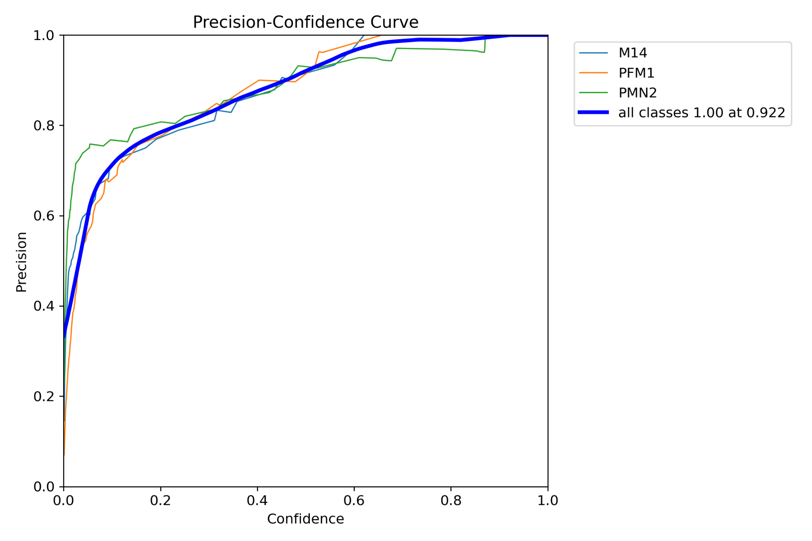
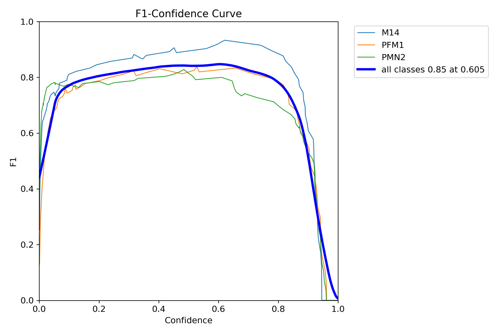
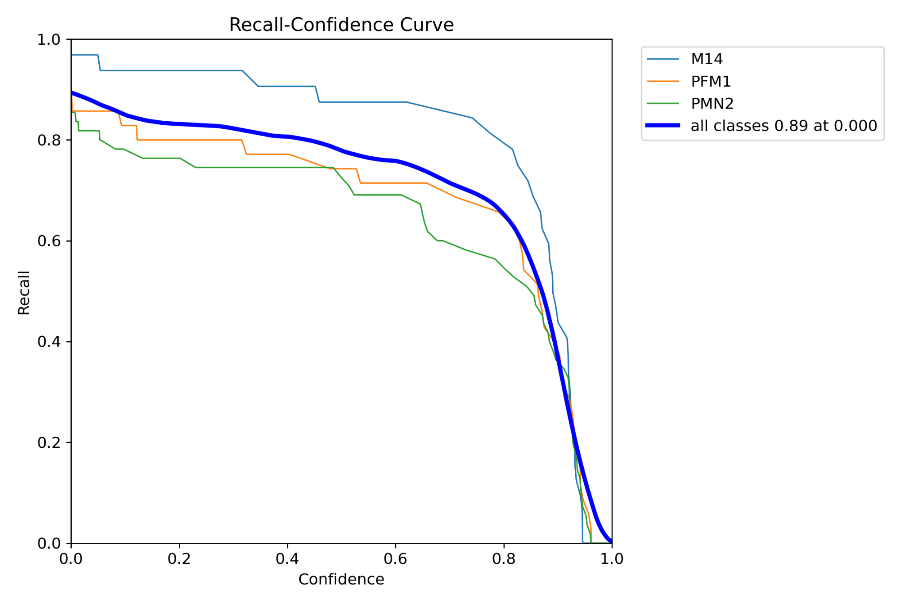
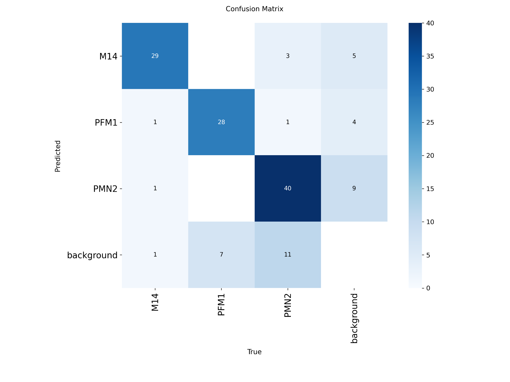
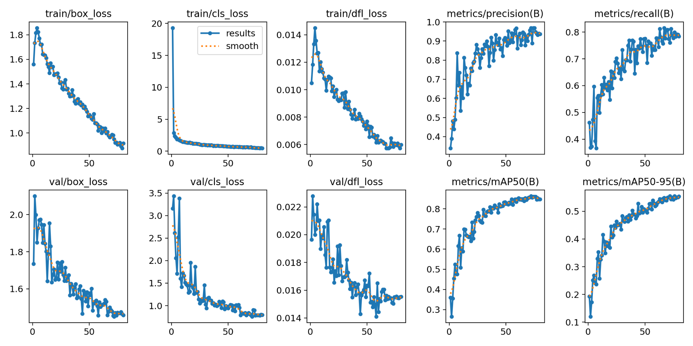

# 01 — YOLO detection of inert 3D-printed mine mockups

## Objective

Train and use a YOLO-based computer-vision model to detect three classes of **nonfunctional, 3D-printed mine-shaped mockups**, with additional work on video inference and small-object detection.

## Submitted artifacts

- `weights/best263D.pt`: original submitted checkpoint file (not independently loaded or tested by this package).
- `src/original/pic.py`: YOLO image inference, custom bounding-box annotation and JPEG export.
- `src/original/import cv2 as cv.py`: custom-weight video detection and annotated MP4 output.
- `src/original/video.py`: SAHI tiled inference; custom IoU/IoS and greedy non-maximum merging; frame skipping and HUD output.
- `results/`: supplied precision, F1 and recall confidence curves, confusion matrix and training plots.

## Classes

The **uploaded evaluation figures** specify `M14`, `PFM1`, `PMN2`. The code files do not consistently agree with this mapping: `pic.py` labels all predictions as PMN2, whereas `video.py` uses generic placeholders (`mine`, `mine_cluster`, `suspicious`). Use the checkpoint's own `model.names` for verified inference labels instead of copying either placeholder mapping.

## Selected figure-backed results

| Curve annotation | Value | How to interpret |
|---|---:|---|
| Aggregate F1 | 0.85 at confidence 0.605 | The best F1 threshold shown on the supplied chart |
| Aggregate precision | 1.00 at confidence 0.922 | Very stringent threshold; recall can be low there |
| Aggregate recall | 0.89 at confidence 0.000 | Recall at essentially zero confidence cutoff |

These results are reported directly from the uploaded charts and have not been independently recomputed. The `results/training_curves.png` plot shows training and validation trends but does not provide independent test-set validation. For further analysis see `../../docs/results_interpretation.md`.

## Figures











## Running an inference experiment

From the repository root:

```bash
python tools/run_inference.py --project mine --source /path/to/your/image.jpg
python tools/run_inference.py --project mine --source /path/to/your/video.mp4
```

The generic CLI is a convenience added for this repository, not one of the original scripts. No real-world explosive detection suitability is claimed.

## Limitations and remaining work

- No full training dataset, split definition, original train notebook, or independent test media were provided.
- The submitted checkpoint has not been executed in this package, so exact compatible library versions and internal class mapping remain unverified.
- Video processing every twentieth frame reuses the prior detections and is not object tracking; class totals in the original video script count detection events, not unique objects.
- SAHI/NMM settings are supplied in the original code but have not been quantitatively benchmarked against plain YOLO here.
